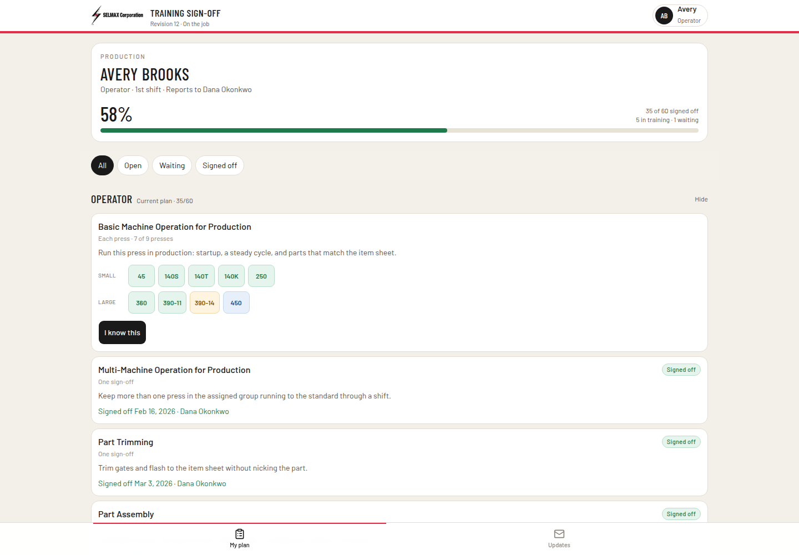
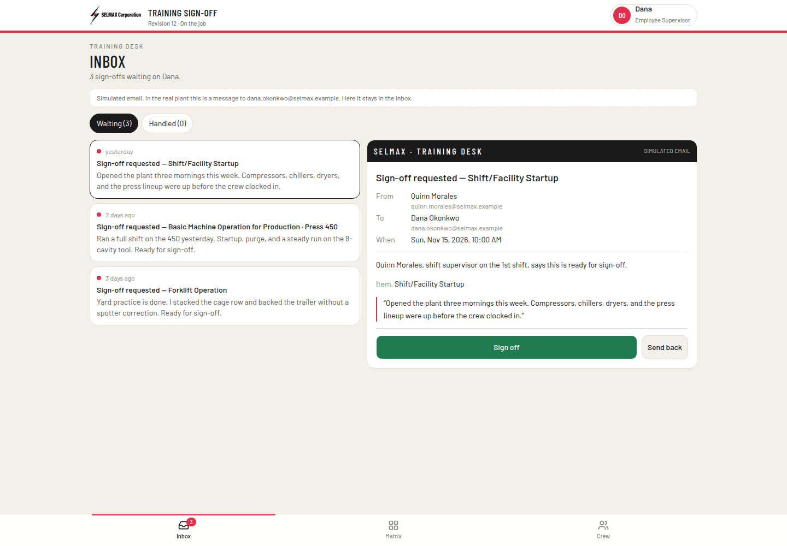
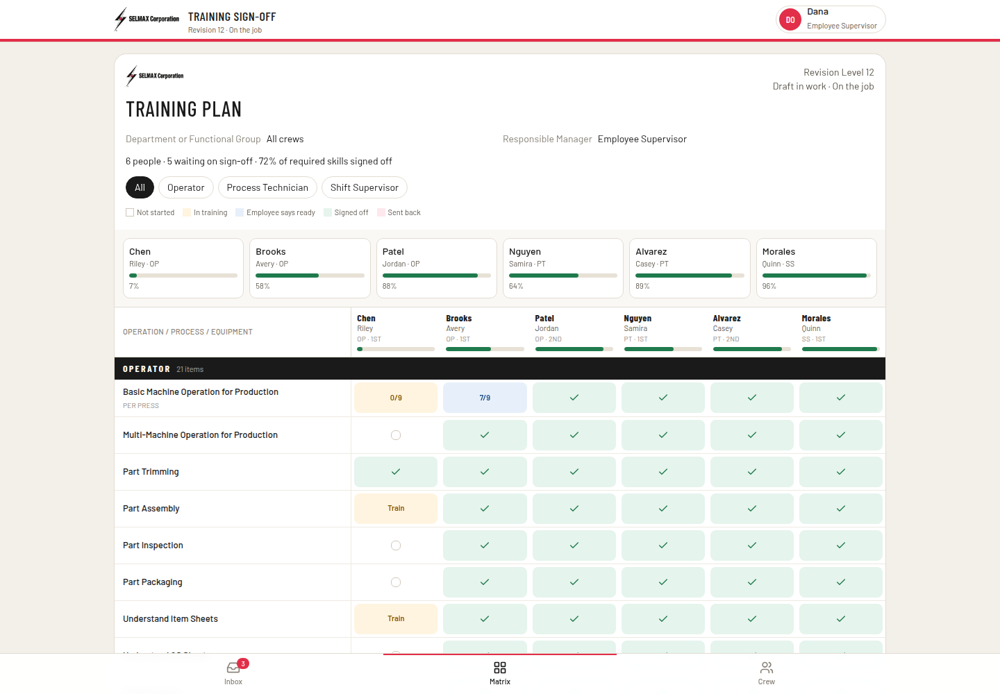

# Selmax training sign-off

A clickable draft of Selmax Corporation’s on-the-job **Training Plan, Revision Level 12**. Operators say when they know a skill. The Employee Supervisor signs it off, or sends it back with a comment. Every step keeps a name, a date, and a history.

The people in the app are a **sample crew**. They are not real employees.

Selmax is a custom injection molder in Selinsgrove, Pennsylvania (ISO 9001:2015, on South High Street since 1971). The mark is the bolt from their public site. The live site was behind a login when this demo was built, so the logo is their published mark and the colors follow it: black, paper white, and the red in the bolt.

## Run it

```bash
npm install
npm run dev
```

Open [http://127.0.0.1:43123/Selmax-training-tracker/](http://127.0.0.1:43123/Selmax-training-tracker/). The app is built for that subpath so the same files work on GitHub Pages.

A static export for Pages:

```bash
npm run build
```

The site is the `out/` folder (includes `.nojekyll` and `404.html`). Published, it is [https://docgrd.github.io/Selmax-training-tracker/](https://docgrd.github.io/Selmax-training-tracker/).

Pick a person. There is no password. The sample plant lives in this browser. **Reset demo data** in the person menu puts every sign-off and inbox message back.

A production build is the same app:

```bash
npm run build
npm start
```

## Show it in a few minutes

1. Sign in as **Riley Chen**, a new operator. Open Part Inspection and tap **I know this**. A note is optional.
2. Sign in as **Dana Okonkwo**, Riley’s Employee Supervisor. The request is in the inbox, written the way an email would read. A few other requests are already waiting.
3. **Sign off** (today’s date and Dana’s name) or **Send back** with a comment. Open the skill again to see the history.
4. Open the **matrix**. Rows are the Revision 12 items. Columns are the crew. A machine skill shows how many presses are signed off. Tap a cell for that history.

The walkthrough button on the sign-in screen does the same four steps.







## What the plan covers

Career path: Operator → Process Technician → Shift Supervisor. A person sees their current plan and the earlier plans as prerequisites.

Some skills are signed off **per press**. Small presses: 45, 140S, 140T, 140K, 250. Large presses: 360, 390-11 (Toshiba EC390SX 2011), 390-14 (Toshiba EC390SX 2014), 450 (Kawaguchi KM450). Chameleon processing follows that split. One plant-wide skill, such as forklift or the operator form, is a single sign-off.

The matrix still carries the paper questions: training risks, and the actions needed to achieve the plan. A supervisor can edit both. They stay in this browser with the rest of the demo.

## Where a real login would go

Sign-in is an adapter in `lib/auth.ts`. The demo adapter stores the chosen person in the browser. `createSupabaseAuthAdapter()` is the same shape and is not wired up. Swap the `auth` export when `NEXT_PUBLIC_SUPABASE_URL` and `NEXT_PUBLIC_SUPABASE_ANON_KEY` exist.

Training records are a separate store in `lib/store.tsx` (start, request sign-off, approve, send back). Those actions are what a Supabase table and row-level security would take over: an employee can move their own skill to “ready”; only their Employee Supervisor can sign it off or send it back.

## Pitch: what to build next

This is a draft for the conversation, not the system of record.

1. **Real logins.** Replace the person picker with company accounts (Supabase, or Microsoft 365 if that is already how people sign in). The adapter above is the seam. Keep the rule that the Employee Supervisor, not the software, decides the skill is met.
2. **Email, for real.** The inbox cards are the message. Send that message to the supervisor when someone taps “I know this,” and back to the employee when it is signed off or sent back. The floor should not have to go looking.
3. **Export for audits and ISO records.** A CSV or PDF of the matrix, plus the history on each skill: who said they were ready, who signed, the date, and any comment sent back. That is the packet a registrar asks for, and it replaces the clipboard copy of Revision 12.
4. **Tie each skill to the work instruction.** Item sheets, QC sheets, the operator form, and the Chameleon form already live at the press. Link the skill to the current revision of that document so “I know this” sits next to the standard, not in a separate binder.
5. **Let scheduling see the presses.** A sign-off on the 450 is not a sign-off on the 140S. Shift assignment can offer a press only to someone signed off on it.

Reset the demo any time from the person menu. Nothing here leaves the browser.
